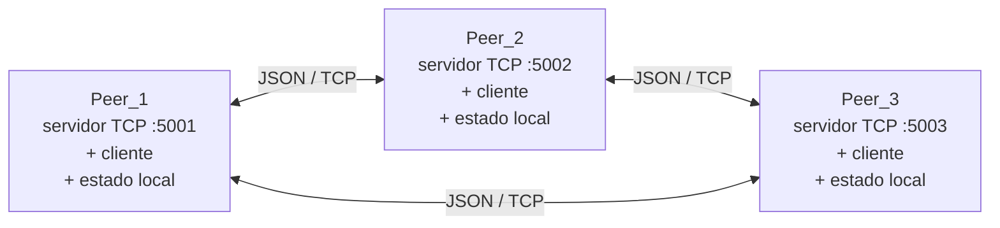
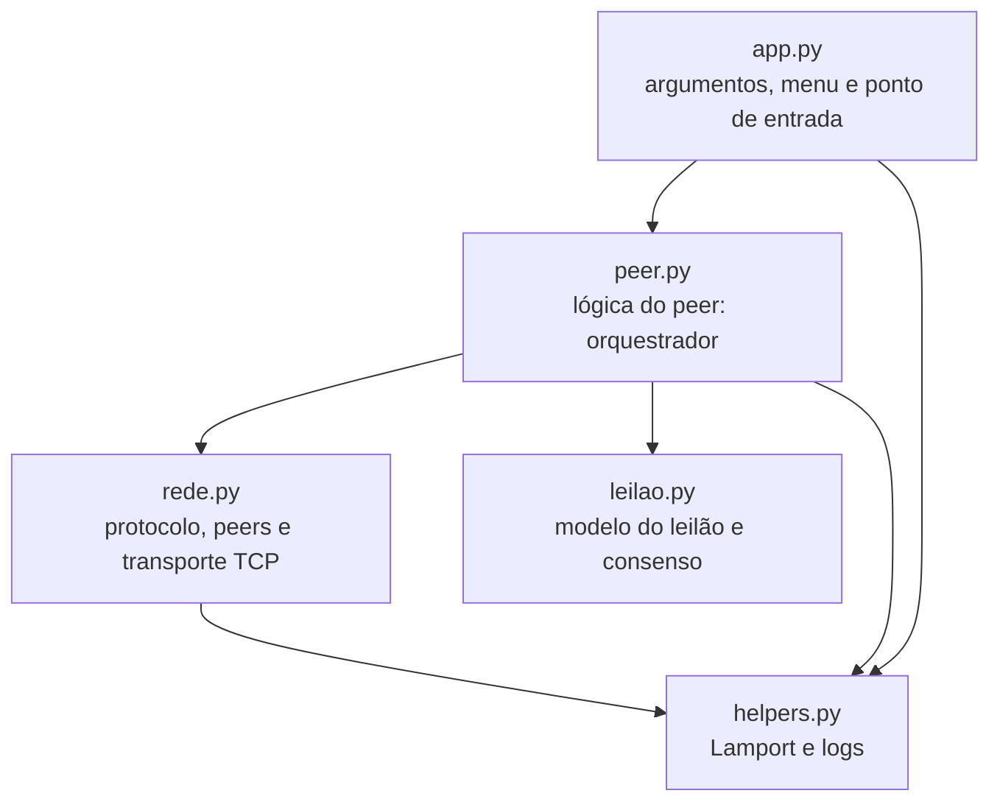

# Leilão Distribuído P2P (Grupo 5)

Projeto Prático de Laboratório · Sistemas Distribuídos e Computação Paralela · PUC-SP · 2º semestre de 2026 · Prof. Carlos Paes

## Integrantes

| Nome | RA | Responsabilidade |
|---|---|---|
| Guilherme Schnekenberg Teixeira | RA00336189 | Servidor TCP assíncrono e documentação |
| Luís Augusto Coelho | RA00331675 | Cliente, CLI e propagação de lances |
| Matheus Heimrath Barbosa | RA00333095 | Estado local, regras do leilão e protocolo JSON |
| Pedro Henrique Vianna Carvalho | RA00333196 | Experimentos de falha e concorrência |

## Tecnologia e paradigma

**P2P (Peer-to-Peer)**: arquitetura descentralizada em que cada nó (peer) é cliente e servidor ao mesmo tempo. Não há leiloeiro central: cada peer guarda localmente o estado do leilão, envia seus lances diretamente a todos os outros e, no encerramento, anuncia quem considera o vencedor. Os peers então verificam se todos concordam.

- **Comunicação:** direta (peer a peer, sem broker), síncrona no nível de cada mensagem (requisição/resposta sobre TCP).
- **Implementação:** Python 3.10+ apenas com a biblioteca padrão (`asyncio` para sockets TCP não bloqueantes, `json` para serialização).

## Arquitetura da POC



Cada conexão TCP transporta **uma mensagem e uma resposta**, ambas como uma linha JSON terminada em `\n`.

## Organização do código

São cinco arquivos. A interface (texto e interação) fica separada da lógica do programa:



| Arquivo | Conteúdo |
|---|---|
| `app.py` | Interface: lê os argumentos de linha de comando, mostra o menu, lê o teclado e é o ponto de entrada do programa. Não contém regra de negócio. |
| `peer.py` | Lógica do peer (classe `Peer`): orquestra os outros módulos, despacha as mensagens recebidas, dá lances, faz handshake e encerra o leilão. Não lê o teclado. |
| `rede.py` | Tudo que é rede: tipos de mensagem e serialização JSON, registro de peers conhecidos (`RegistroPeers`) e servidor/cliente TCP com timeout (`Transporte`). Não conhece as regras do leilão. |
| `leilao.py` | Modelo do leilão: tipo `Lance`, regra de desempate `supera()`, estado local (`Leilao`) e verificação de consenso (`ColetorAnuncios`). Não faz rede nem imprime nada. |
| `helpers.py` | Relógio de Lamport e funções de log. |

Como o `peer.py` não depende da interface, outra interface (web, por exemplo, um dos extras opcionais) poderia usar a mesma classe `Peer` sem mudar a lógica.

Como o `leilao.py` não depende de rede, ele pode ser testado isoladamente:

```python
from leilao import Leilao, Lance

l = Leilao("Notebook", 1000)
print(l.avaliar(Lance(1200, "Peer_1", 1)))   # aceito
print(l.avaliar(Lance(1100, "Peer_2", 2)))   # recusado
```

### Fluxo de uma mensagem recebida

1. O `Transporte` (rede.py) recebe a linha JSON e chama o tratador fornecido pelo `Peer`.
2. `Peer._tratar` (peer.py) atualiza o relógio de Lamport, registra o remetente e despacha para `_em_handshake`, `_em_lance` ou `_em_anuncio`.
3. O tratador consulta o `Leilao` ou o `ColetorAnuncios` (leilao.py) e devolve a resposta, que o transporte envia de volta.

### Concorrência dentro de um peer

O `asyncio` roda em uma única thread e só troca de tarefa em um `await`. O tratamento de mensagens é síncrono, então nunca é interrompido no meio: duas mensagens que chegam juntas são processadas uma de cada vez. Por isso não há `Lock`. Entre peers diferentes **não existe exclusão mútua**: a convergência vem de uma regra determinística.

## Regras do leilão

- **Primeiro lance:** precisa ser maior ou igual ao lance mínimo.
- **Lances seguintes:** precisam superar o maior lance atual.
- **Desempate determinístico:** quando dois lances têm o mesmo valor, vence o que tem o **menor relógio de Lamport** (o que "aconteceu antes" na ordem lógica). Se o Lamport também empatar, vence o menor id de peer. Como todos os peers aplicam a mesma regra, todos chegam ao mesmo vencedor, qualquer que seja a ordem de chegada.
- **Horário de encerramento:** se os peers conhecem horários diferentes, vale o **mais cedo**.
- **Após o encerramento:** o maior lance fica congelado e novos lances são recusados.

### Descoberta de peers

Cada peer recebe uma lista de endereços em `--peers`. Ao iniciar, faz HANDSHAKE com todos: troca o estado do leilão e a lista de peers conhecidos, então um peer novo descobre os demais a partir de um único contato. A lista pode incluir o próprio endereço (ele é ignorado), então todos podem usar a mesma lista.

## Formato das mensagens

Campos comuns a todas as mensagens:

| Campo | Tipo | Descrição |
|---|---|---|
| `tipo` | string | Tipo da mensagem (tabela abaixo) |
| `peer_origem_id` | string | Id de quem enviou |
| `porta` | int | Porta em que o remetente escuta (para ser registrado como peer) |
| `lamport` | int | Relógio de Lamport do remetente no envio |

Um **lance** é `{"valor": float, "peer_id": string, "lamport": int}`.
O **estado** é `{"item", "lance_minimo", "maior_lance" (lance ou null), "encerra_em" (epoch em segundos ou null), "encerrado"}`.

| Tipo | Direção | Campos específicos | Uso |
|---|---|---|---|
| `HANDSHAKE` | requisição | `estado` | Entrar na rede e sincronizar o estado |
| `HANDSHAKE_OK` | resposta | `estado`, `peers` | Devolve estado e lista de peers conhecidos |
| `LANCE_PROPOSTA` | requisição | `lance` | Envia um lance a um peer |
| `LANCE_RESPOSTA` | resposta | `status` (ACEITO/RECUSADO), `motivo`, `estado` | Resultado do lance naquele peer |
| `VENCEDOR_ANUNCIO` | requisição | `lance` (ou null) | No encerramento: quem este peer considera vencedor |
| `ANUNCIO_OK` | resposta | (nenhum) | Confirma o recebimento do anúncio |
| `ERRO` | resposta | `mensagem` | Tipo de mensagem desconhecido |

Exemplos:

```json
{"tipo": "LANCE_PROPOSTA", "peer_origem_id": "Peer_2", "porta": 5002, "lamport": 11,
 "lance": {"valor": 1500.0, "peer_id": "Peer_2", "lamport": 10}}
```

```json
{"tipo": "LANCE_RESPOSTA", "peer_origem_id": "Peer_1", "porta": 5001, "lamport": 13,
 "status": "ACEITO", "motivo": "novo maior lance",
 "estado": {"item": "Notebook Gamer High-End", "lance_minimo": 1000.0,
            "maior_lance": {"valor": 1500.0, "peer_id": "Peer_2", "lamport": 10},
            "encerra_em": 1793458800.0, "encerrado": false}}
```

```json
{"tipo": "VENCEDOR_ANUNCIO", "peer_origem_id": "Peer_3", "porta": 5003, "lamport": 30,
 "lance": {"valor": 1500.0, "peer_id": "Peer_2", "lamport": 10}}
```

Para ver o JSON bruto de todas as mensagens durante a execução, use a opção `-v`.

## Como executar

Requisitos: Python 3.10 ou superior. Não há dependências externas. Execute os comandos na pasta onde estão os arquivos `.py`. O ponto de entrada é o `app.py`.

### Opções

| Opção | Descrição |
|---|---|
| `ID PORTA` | Id único do peer e porta TCP local (obrigatórios) |
| `--peers IP:PORTA,...` | Outros peers (pode incluir o próprio endereço) |
| `--duracao S` | Leilão termina S segundos após iniciar este peer |
| `--encerra-em HH:MM` | Leilão termina neste horário (relógio local) |
| `--item "..."` / `--minimo V` | Descrição do item e lance mínimo |
| `--sem-desempate` | Desliga a regra de desempate (experimento RE3) |
| `--espera-anuncios S` | Tempo aguardando anúncios no encerramento (padrão 5 s) |
| `-v` | Mostra o JSON bruto das mensagens |

Basta **um** peer definir o encerramento (`--duracao` ou `--encerra-em`); os demais o recebem no handshake.

### Em uma máquina (3 terminais)

```bash
python app.py Peer_1 5001 --peers 127.0.0.1:5002,127.0.0.1:5003 --duracao 300
python app.py Peer_2 5002 --peers 127.0.0.1:5001
python app.py Peer_3 5003 --peers 127.0.0.1:5001
```

### Em duas ou mais máquinas (RE1)

1. Descubram o IP de cada máquina na rede (`ipconfig` no Windows, `ip a` no Linux, `ifconfig` no macOS).
2. Liberem as portas no firewall (no Windows, aceitem o aviso na primeira execução).
3. Usem os **IPs reais da rede** (não `127.0.0.1`) quando houver mais de uma máquina.
4. Se a rede da universidade bloquear conexões entre dispositivos, usem o hotspot de um celular.

Exemplo com a Máquina A (`192.168.0.10`) rodando Peer_1 e a Máquina B (`192.168.0.11`) rodando Peer_2 e Peer_3:

```bash
# Máquina A
python app.py Peer_1 5001 --peers 192.168.0.11:5002,192.168.0.11:5003 --duracao 300
# Máquina B (dois terminais)
python app.py Peer_2 5002 --peers 192.168.0.10:5001
python app.py Peer_3 5003 --peers 192.168.0.10:5001
```

### Teste automatizado local

O `teste_local.py` sobe 3 peers na mesma máquina, executa uma linha do tempo de ações e verifica os resultados:

```bash
python teste_local.py            # os três cenários (cerca de 1 minuto)
python teste_local.py normal     # descoberta, lances recusados e consenso
python teste_local.py empate     # RE3 sem desempate (tenta até 5 vezes obter divergência)
python teste_local.py falha      # RE2: derruba e reinicia um peer
```

Os logs completos ficam em `logs_teste/`. Usa as portas 6001 a 6063.

### Menu de cada peer

1. **Dar um lance:** valida localmente e envia a todos os peers, mostrando quem aceitou e quem recusou.
2. **Ver estado:** maior lance, quem deu, horário de encerramento, tempo restante, relógio de Lamport e peers conhecidos.
3. **Conectar a um novo peer:** handshake manual com um endereço.
4. **Ressincronizar:** handshake com todos os peers conhecidos.
0. **Sair.**

### Etiquetas do log

| Etiqueta | Significado |
|---|---|
| `[INFO]` | Informações gerais |
| `[PEER]` | Descoberta de peers e handshake |
| `[LANCE]` | Lances enviados, recebidos, aceitos e recusados |
| `[SYNC]` | Estado atualizado a partir de outro peer |
| `[FIM]` | Encerramento, anúncios e consenso |
| `[AVISO]` | Falhas e situações anormais |
| `[JSON]` | Mensagens brutas (com `-v`) |

## O que observar na demonstração

1. Ao iniciar, os peers se descobrem e sincronizam o horário de encerramento (`[PEER]` e `[SYNC]`).
2. Um lance dado em um peer aparece como `[LANCE] NOVO MAIOR LANCE` em todos os outros (RF4).
3. Um lance menor que o atual é recusado (RF3).
4. No horário, cada peer anuncia o vencedor e imprime a **verificação de consenso** (RF5).

## Experimentos

### RE2: falha de um peer

**Procedimento:** com o leilão em andamento, encerrar um peer com `Ctrl+C`, dar um lance em outro peer, e reiniciar o peer derrubado com o mesmo comando. Variação: em vez de `Ctrl+C`, desligar o Wi-Fi da máquina (aparece `timeout` em vez de `ConnectionRefusedError`).

**Comportamento esperado:**
- Os outros peers continuam funcionando normalmente: não existe ponto único de falha.
- Quem dá o lance vê `[AVISO] Peer_X inacessível` e o resumo `1 aceitaram, 0 recusaram, 1 inacessível(is)`.
- Ao reiniciar, o peer perde o estado (que fica só em memória), mas o **handshake o recupera** dos outros peers: o maior lance dado durante a queda e o horário de encerramento original (mesmo se reiniciado com outra `--duracao`, pois vale o mais cedo).

Saída obtida nos testes, no peer reiniciado:

```
[SYNC] Encerramento sincronizado: 13:53:08 (relógio local)
[SYNC] Maior lance agora é R$ 1800.00 de Peer_3 (Lamport=14)
[PEER] Handshake: 2 peer(s) responderam (2 conhecido(s))
```

**Limitação:** se **todos** os peers caírem, o estado se perde, porque não há persistência em disco.

### RE3: lances simultâneos

**Procedimento:** em dois peers, digitar o mesmo valor (por exemplo, R$ 1500) e apertar Enter ao mesmo tempo. Repetir com `--sem-desempate` em todos os peers.

**Comportamento esperado:**
- **Com o desempate:** cada peer pode receber os lances em ordem diferente, mas todos aplicam a mesma regra (valor, depois menor Lamport, depois menor id). No fim **todos convergem** e a verificação mostra `CONSENSO`.
- **Sem o desempate:** cada peer fica com o lance que chegou primeiro nele. Os peers divergem e a verificação mostra `DIVERGÊNCIA`.

Saída obtida nos testes com `--sem-desempate`:

```
  igual        Peer_1       R$ 1500.00 de Peer_3 (Lamport=14)
  DIFERENTE    Peer_2       R$ 1500.00 de Peer_2 (Lamport=16)
  igual        Peer_3       R$ 1500.00 de Peer_3 (Lamport=14)
  --------------------------------------------------------
  DIVERGÊNCIA: Peer_2 discorda(m) do meu resultado.
```

### Sincronização de relógios

O encerramento usa o relógio **local** de cada máquina. Se os relógios estiverem diferentes, um peer encerra antes do outro e pode recusar um lance que outro aceitou. O programa avisa quando recebe um anúncio de vencedor antes do próprio encerramento (`[AVISO] Pelo meu relógio ainda faltam X s...`). Para observar isso, ajustem o relógio de uma das máquinas em alguns segundos. Esse é o problema da aula de sincronização de relógios (Cristian, Berkeley, NTP): o relógio de Lamport resolve a **ordem** dos eventos, mas não o **horário** real.

## Limitações conhecidas

- Estado apenas em memória (sem persistência).
- Sem autenticação: qualquer processo na rede pode enviar mensagens.
- A verificação de consenso **detecta** divergência, mas não a corrige (isso exigiria um algoritmo de consenso, como Paxos ou Raft).
- O broadcast é feito pelo próprio peer que deu o lance; se ele cair no meio do envio, alguns peers podem não receber o lance até o próximo handshake.

## Estrutura do repositório

```
app.py             argumentos, menu e ponto de entrada
peer.py            lógica do peer (orquestrador)
rede.py            protocolo, peers conhecidos e transporte TCP
leilao.py          modelo do leilão e consenso
helpers.py         relógio de Lamport e logs
teste_local.py     teste automatizado com 3 peers locais
requirements.txt   sem dependências externas
README.md          este arquivo
IA.md              registro do uso de IA
slides/            apresentação do seminário
```
